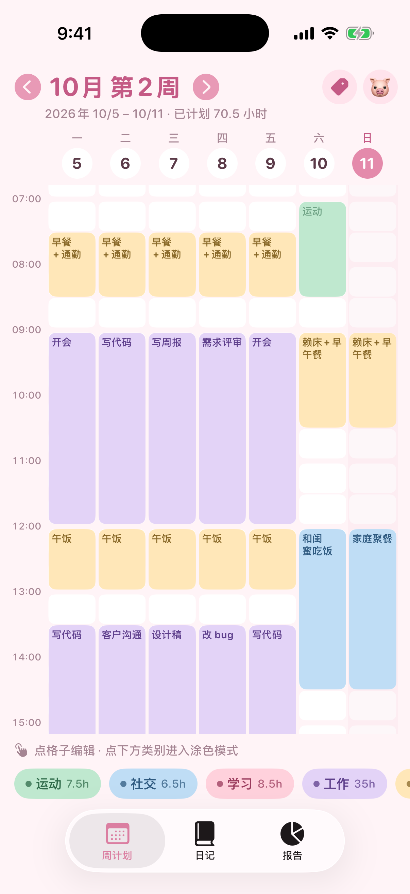
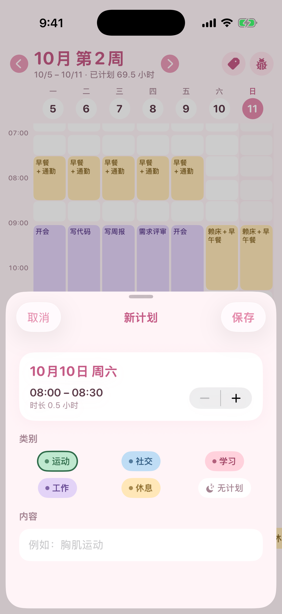
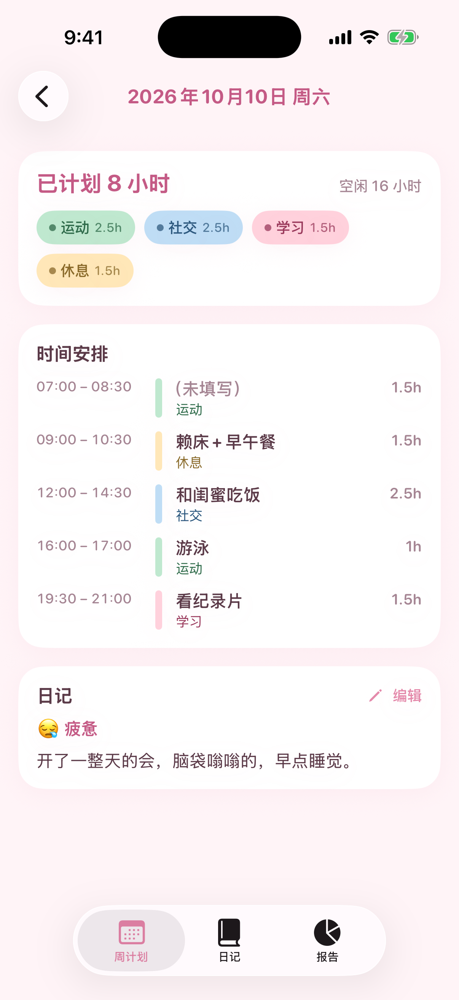
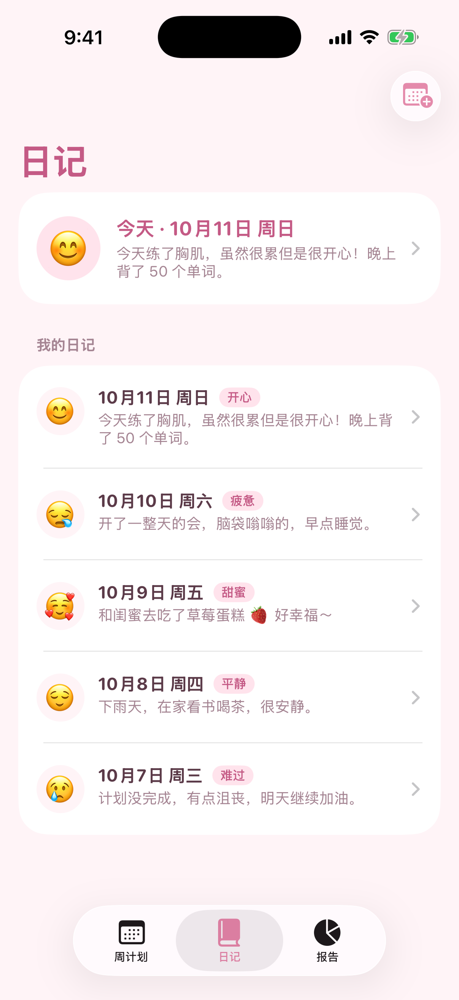
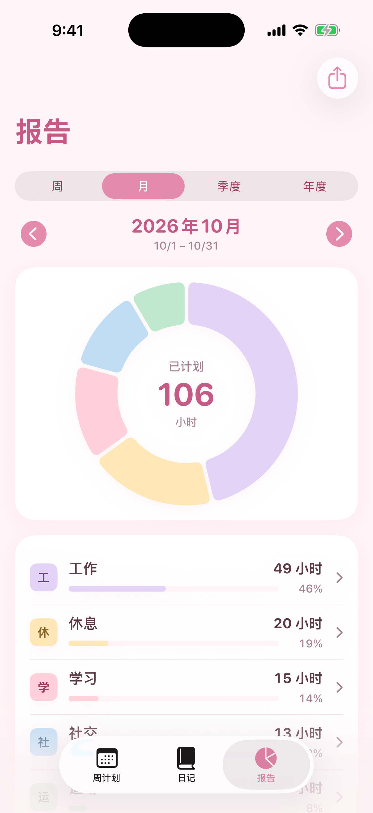
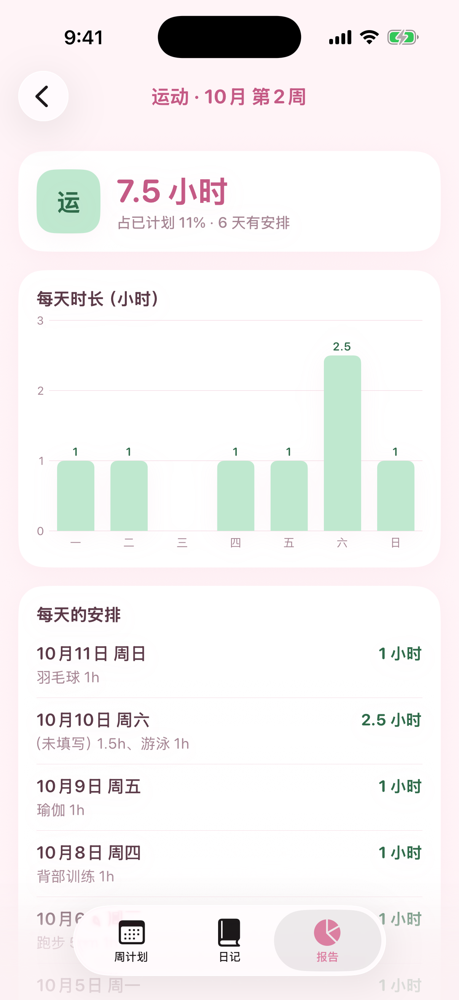
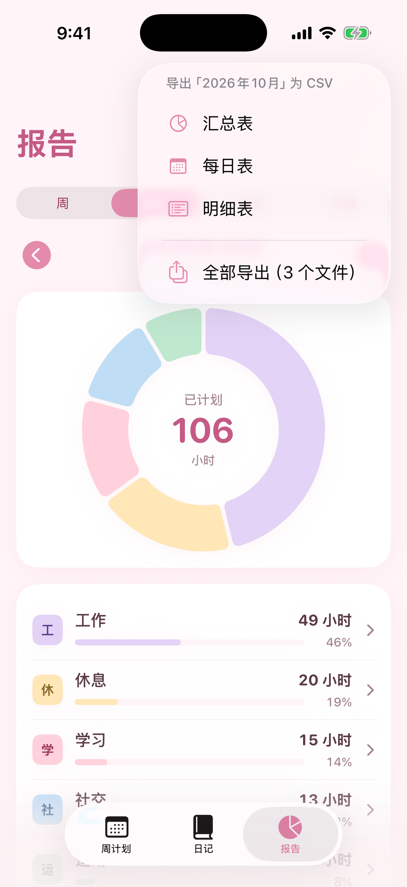
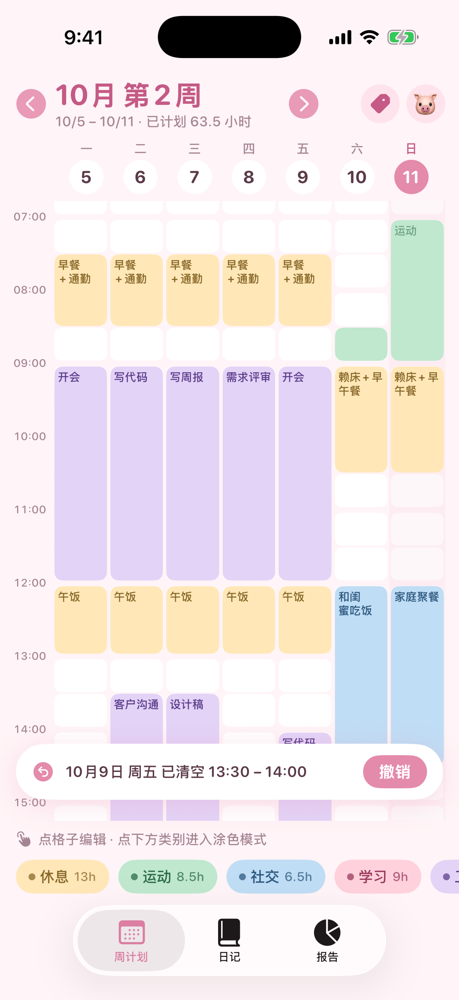

# Baobaoweekly 🍓

一个马卡龙少女风的 iPhone 周计划 App：把一周切成 30 分钟的小格子，用颜色（类别）和一句话（内容）把时间“涂”出来，再配上每天一则小日记和按周 / 月 / 季度 / 年度的时间报告。

原生 SwiftUI + SwiftData，数据只保存在手机本地，没有账号、没有联网、没有第三方依赖。

> 设计思路与决策记录见 [DESIGN.md](DESIGN.md)。

<p>
  
  
  
  
</p>
<p>
  
  
  
  
</p>

## 功能

- **周计划（主屏）**：周一开始的 7 天 × 48 个半小时格子（00:00–24:00），打开时自动滚到 07:00；标题“10月 第2周”，副标题带年份和本周已计划小时数（如“2026年 10/5 – 10/11 · 已计划 69 小时”，跨年周显示“2026/12/28 – 2027/1/3”）。左右箭头或在表头左右滑动切换周。
- **点格子编辑**：选类别（或“无计划”）、写内容（如“胸肌运动”）、调时长；点在一段连续计划里时，可选“整段”或“只改这半小时”。
- **涂色模式**：点底部的类别小圆片进入，点按或拖动格子快速上色，橡皮可擦除；涂色时用左侧时间栏上下滚动。
- **清空要确认，并可撤销**：清空 / 覆盖已有计划后，底部出现 12 秒的「撤销」。
- **每日详情**：点星期表头，看当天的所有时间段、各类别时长和当天日记。
- **类别管理**：默认 运动 / 社交 / 学习 / 工作 / 休息；可新增、改名、换色（12 个马卡龙色 + 自定义颜色，文字颜色自动加深）、拖动排序、删除（可选同时清空它的计划块，或保留为空闲）。
- **日记**：每天一则，6 种心情 + 自由文字；列表按日期倒序，可打开任意一天。
- **报告**：周 / 月 / 季度 / 年度，前后翻页；甜甜圈图 + 各类别小时数和占比 + 空闲时间。点类别看柱状图（周、月按天，季度按周，年按月）和每天的明细，没写内容的时间显示为「（未填写）」。
- **CSV 导出**：报告页右上角，导出当前周期的 汇总表 / 每日表 / 明细表，或全部导出，可存到“文件”、隔空投送、邮件等，Excel 直接打开不乱码。

## 环境要求

- macOS + **Xcode 26.5**
- **iOS 17.0+**，iPhone（竖屏）
- 无第三方依赖，不需要 CocoaPods / SPM

## 在模拟器里运行

1. 双击打开 `StrawberryWeek.xcodeproj`。
2. 顶部选择 Scheme **StrawberryWeek**，设备选一个模拟器（例如 iPhone 17）。
3. 按 ⌘R。

命令行：

```sh
xcodebuild -scheme StrawberryWeek \
  -destination 'platform=iOS Simulator,name=iPhone 17' build
```

> Debug 版本右上角有一个 🐷 菜单，可以「生成演示数据」或「清空所有计划与日记」。这个菜单和演示数据**只存在于 DEBUG 编译**（`#if DEBUG`），Release 版本里没有，安装后除了 5 个默认类别是空白的。
>
> Debug 版本还支持两个启动参数，方便截图：`-demo YES`（启动时生成演示数据）和 `-startTab 0|1|2`（打开 周计划 / 日记 / 报告）。

## 用免费 Apple ID 安装到自己的 iPhone

1. **登录账号**：Xcode → Settings → Accounts → 左下角 `+` → Apple ID，登录后会出现一个 *Personal Team*。
2. **选择签名团队**：在项目里选中 target **StrawberryWeek** → Signing & Capabilities → 勾选 *Automatically manage signing*，Team 选你的 *Personal Team*。如果提示 Bundle Identifier 已被占用，把 `com.cokeeeeman.strawberryweek` 改成任意唯一的名字（例如加个后缀）。
3. **用 Release 编译**：Product → Scheme → Edit Scheme… → Run → Build Configuration 选 **Release**（这样手机上没有 🐷 调试菜单）。
4. **连接手机**：用数据线连接 iPhone，手机上点「信任此电脑」。
   - 手机在 Xcode 的设备列表里可能只显示为 **“iPhone”**，而不是你给它起的名字，这是正常的。
   - 如果 Xcode 一直不列出手机，可以在终端运行 `xcrun devicectl list devices` 查看，再用 `xcrun devicectl manage pair --device <设备ID>` 手动配对。
5. **打开开发者模式**：iPhone 设置 → 隐私与安全性 → **开发者模式**，打开后重启并确认。
   - 注意：这个开关**要等 Xcode 第一次尝试往手机安装（或配对）之后才会出现**。如果找不到，先在 Xcode 里按一次 ⌘R，失败也没关系，再回去看。
6. **安装**：顶部设备选你的 iPhone，按 **⌘R**。
7. **信任开发者**：第一次打开会提示“不受信任的开发者”。到 设置 → 通用 → **VPN 与设备管理** → 选择你的 Apple ID → 信任。
8. **每 7 天重新安装一次**：免费 Apple ID 的签名只有 7 天有效期，过期后 App 打不开。连上电脑在 Xcode 里再按一次 ⌘R 即可，**数据会保留**。

## 运行测试

单元测试在 `StrawberryWeekTests/`（存储与撤销、CSV 格式与合计、周期边界、标签格式等）：

```sh
xcodebuild test -scheme StrawberryWeek \
  -destination 'platform=iOS Simulator,name=iPhone 17'
```

或在 Xcode 里按 ⌘U。

## 项目结构

```
StrawberryWeek.xcodeproj/        Xcode 工程（文件夹同步，新建文件放进文件夹即可）
StrawberryWeek/
  App/                           入口、Tab、首次启动写入默认类别
  Models/                        SwiftData 模型：PlanCategory / PlanBlock / DiaryEntry
  Theme/                         颜色、马卡龙色板、自动加深文字颜色
  Utils/Cal.swift                日历工具：周一为一周开始、日期与周标题格式
  ViewModels/                    BlockStore（所有写入）、SegmentBuilder（合并连续格子）、
                                 ReportCalculator（报告与周期）、ReportExporter（CSV）
  Views/Week/                    周网格、涂色滚动容器、格子编辑、每日详情
  Views/Categories/              类别管理
  Views/Diary/                   日记列表与编辑
  Views/Reports/                 报告与类别详情
  Views/Components/              小组件、分享面板
  Debug/DemoData.swift           演示数据（仅 DEBUG）
  Assets.xcassets/               App 图标（草莓）与主题色
StrawberryWeekTests/             单元测试
icon_backup/                     图标备份：草莓原图、小猪写作业（PNG + SVG）
screenshots/                     开发过程中的模拟器截图
samples/                         用演示数据导出的 CSV 样例
```

## CSV 导出

在「报告」页选好周期（周 / 月 / 季度 / 年度），点右上角分享按钮：

| 文件 | 内容 |
| --- | --- |
| **汇总表** | 开头几行写明周期（如“2026年10月 第2周 (2026-10-05 ~ 2026-10-11)”）和导出时间；然后每个类别一行：类别、小时、占比(%)（占全部时间）、占已计划(%)（与 App 报告页一致），再加 已计划 / 空闲 / 合计。 |
| **每日表** | 每天一行：日期 (yyyy-MM-dd)、星期、每个类别一列小时数、已计划小时、空闲小时、心情、日记。 |
| **明细表** | 每段连续计划一行：日期、星期、开始、结束、时长(小时)、类别、内容。 |

- 文件名形如 `Baobaoweekly_周报_2026-10-05_2026-10-11_汇总.csv`（月报 / 季报 / 年报 同理）。
- UTF-8 带 BOM、CRLF 换行、标准 RFC 4180 引号转义，Excel（Mac / Windows）直接双击打开中文不乱码；日记里的逗号、引号、换行都能正确保存。
- 小时是纯数字（如 `1.5`），方便在 Excel 里求和。
- 已删除类别留下的、还带文字的计划块记为「未分类」，计入空闲时间，所以各表合计与 App 内报告一致。
- 样例见 [`samples/`](samples/)。

**数据只存在手机上**，换手机或删除 App 会丢失。想长期保存，请定期用「全部导出」把 CSV 存到“文件” / iCloud Drive。
